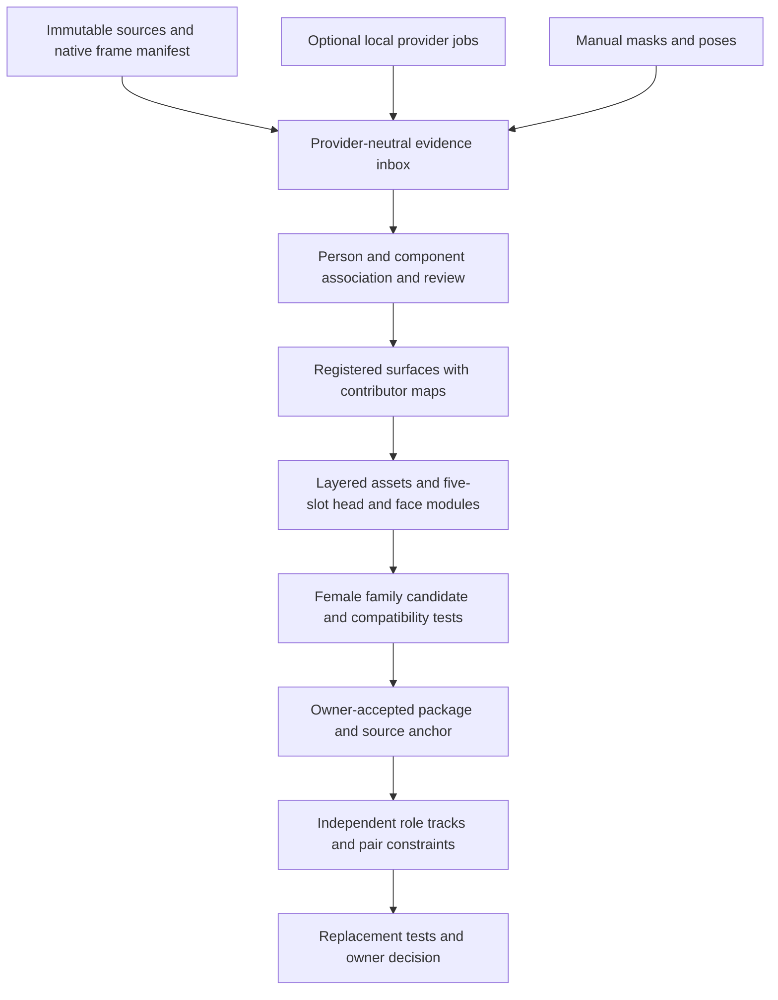

# Final target architecture — proposed for implementation approval

Status: design contract, not implemented or accepted. Authority is the owner's latest poser correction and preflight-only limit, then the approved Gate 2C technology direction and Gate 2B contracts where consistent with that correction. The 02.2.5 baseline remains immutable; its behavior tests do not freeze a future poser implementation. The older run contract supplies role separation, not authority to execute an obsolete broad survey. Architecture changes require a recorded decision and independent audit; universal skeleton 1.2.0 cannot change without separate owner approval.

## Product boundary and complete flow

Prepared single-color/low-detail footage → source/frame inventory → foreground support → pose evidence → semantic component proposals → persistent component tracks and review → body/view registration → contributor-preserving canonical surfaces → layered hair/garment/accessory authoring and head/face registration → proposed FEMALE_STANDARD_V1 character candidate → animation and selected production-poser tests, including preserved v0.4.13 artwork migration/reference checks → explicitly accepted known female package/source binding → reusable Role A/Role B performances and relationship channels → tested compatible female substitution.

The first family contains broadly similar female proportions/scale; male families remain deferred. A foreground mask is not a garment asset. A tracked person is not a Known Character Anchor. Providers never assign canonical identity, review, evidence origin, acceptance or skeleton topology.

## Poser architecture selection and protected language

The project remains100% 2D. v0.4.13 and the 16 recovered PNGs are authoritative historical/reference artwork, an anatomical/visual baseline and migration/test specimen. Preserve their exact bytes and identities; do not freeze their 20-layer hierarchy, parents, pivots, sockets, renderer or deformation. The selected poser may adapt, hybridize or replace that implementation entirely. New subdivisions, meshes, skinning, overlap, shape keys, variants and sockets are permitted as versioned derivatives.

Early bounded milestone M02P compares current-rig adaptation, a Corpus Pane-native design and a sensible hybrid under [POSER_ARCHITECTURE_SELECTION.md](POSER_ARCHITECTURE_SELECTION.md). Common measured criteria govern selection; no winner is asserted here. Production-specific bindings/rendering freeze only after its independent comparison. M09 revalidates with actual canonicalized assets. Failure to retain historical topology is not a failure.

Universal skeleton1.2.0 remains the canonical evidence/motion language. Internal2D deformation controls/hierarchy may differ, with explicit tested mapping to that language. Body motion, head identity, five-slot face, hair, layered garments and accessories stay independently replaceable; anatomy/art pivot/socket and Corpus Pane provenance/review authority stay distinct. No destructive loss of source art or acceptance history is allowed. The owner has not approved importing unapproved later v0.5 rig files; independent new design is a different matter.

## Runtime and ownership boundaries

| Boundary | Responsibility | Interface / persistence |
|---|---|---|
| Browser UI | Intake, source-time inspection, prompts, corrections, topology/binding/face authoring, deterministic 2D replay | Typed commands create revisions; UI never mutates raw observations or marks model output verified |
| Browser Web Workers | Mesh construction, fit/resample, hash/ZIP operations exceeding interactive budgets | Transferable arrays; immutable request/revision IDs; cancellable batches; no direct database writes |
| Domain core | Identity, vocabulary/skeleton, evidence-state rules, surfaces, bindings, family compatibility, pair constraints, review freshness | Validated records and commands; no imports of torch/ONNX/SAM or foreign skeletons |
| Persistence | New authoring database and portable bundles, source/record/blob hashes, transactional heads | Copy-on-write; staged imports; export/import preserves exact legacy snapshot |
| Local host | Same-origin static delivery and authenticated loopback job controller | Node 24.18.0 built-ins; no framework/runtime network; protocol 1.0.0 |
| Optional provider processes | SAM 2.1, future cleared DWPose, offline ARAP | Separate locked environments; one active heavy job; CAS input/output; proposal inbox only |
| Independent verification | Schema, provenance, geometry, migration and runtime checks | Reports bound to exact commit, asset, dependency and test revisions |

Default runtime uses browser Canvas2D/WebGL2 and Node built-ins for serving. Python/models are unnecessary for manual masks, poses, authoring, playback or export. Browser APIs support preview/decode; native-PTS evidence requires a verified frame manifest. A source without reliable native PTS can be previewed but cannot produce time-certified observations. Owner-prepared PNG/PTS manifests are the deterministic fallback; an unaudited FFmpeg executable is not required.

## Provider-neutral evidence adapter

`capabilities()` returns tasks, raw topology/semantic vocabulary, code/model identity, transforms and resource caps. `submit(JobRequest)`, `cancel(jobId)`, `events(jobId, afterSeq)` and `result(jobId)` form the external interface. Output contains immutable raw observations, raw label/landmark dictionary, confidence values with declared meaning, masks/landmarks, native frame references, provider code/config/checkpoint hashes, timing/memory methodology, warnings and failures. Canonical mapping is a separately versioned Corpus Pane record.

Keep raw 133-point DWPose observations intact if its optional weights later clear licensing. Map selected landmarks to skeleton 1.2.0 with reviewed rules; hand/foot/face extras remain evidence. Preserve MoveNet's raw 17-point topology/scores independently. Confidence thresholds are provider-specific. Manual observations use the same contract with actor/tool identity and `checkpoint=null`.

## Persistent identities and revisions

Logical IDs are Corpus Pane UUIDv4 values retained through import. Every edit creates an immutable revision UUID, parent revision references, author/time and derivation references. Record bytes have SHA-256 identities in an external manifest; entity IDs are not content hashes. Identical revision import is idempotent; a reused revision ID with different bytes is quarantined. Colliding logical histories require an explicit fork/mapping event.

`PersonIdentity` is a source-context participant, not a facial identity. `ComponentIdentity` belongs to that participant and persists across clips only through reviewed association. `HeadIdentity` is a reusable asset identity. Provider track IDs remain local to a run. Split/merge/ownership corrections create association revisions and preserve competing hypotheses. A frame-local mask cannot quietly become an accepted asset.

Source hashes identify container bytes. Frames identify stream, inventory index, integer native PTS/time base, decoded-pixel hash and decoder identity. Duplicate PTS and VFR frames remain distinct. Source coordinates are pixels, top-left origin, x right/y down. Anatomical LEFT/RIGHT refers to the subject. Store every crop/resize/mirror transform; screen position cannot determine anatomical side. Seconds are a display convenience; evidence uses rational native time.

## Four spatial evidence states

A surface carries independent RGBA, valid coverage, visibility, uncertainty and per-texel origin/contributors. Codes: 0 UNKNOWN, 1 OBSERVED, 2 RECOVERED, 3 INFERRED. OBSERVED cites visible support in its designated reference observation. RECOVERED cites a specifically different visible frame and registration. INFERRED cites a named reconstruction/inpainting/manual invention process, settings and inputs. UNKNOWN has no resolved content assertion. Segmenting visible source pixels with a model does not make their texture inferred; mask confidence and pixel origin are separate axes.

Mixed blends retain every contributor/weight. Any nonzero inferred contribution gives a conservative INFERRED summary while preserving observed/recovered contributors. Transparent texture is not necessarily UNKNOWN. Baking, trimming, exporting and reopening cannot upgrade inferred pixels. See [SCHEMA_EXTENSION_PLAN.md](SCHEMA_EXTENSION_PLAN.md).

## Canonical surfaces and layered packages

`CanonicalSurface` is a component/view-specific 2D domain registered to a bind-pose/calibration revision, not automatically a body UV atlas or 3D reconstruction. It contains texture, coverage, origin/contributors, source transforms, correspondence/residuals, boundary ambiguity and conflict/rejection masks. Complementary visible frames fill RECOVERED regions; incompatible folds/views produce variants or UNKNOWN rather than automatic averaging.

`LayeredAssetPackage` contains garment/hair/accessory subparts and surfaces per view. Each subpart names body-region coverage, anatomy binding, artwork pivot, sockets, rigid/skinned/shape-key/baked behavior, seams, intentional overlap polygons, draw order, pose/view envelope, source evidence and compatibility tests. Garments use construction-aware sleeves, torso sections, pelvis/skirt panels, collars, straps or flaps as applicable. Hair may use rear mass, side locks and front fringe. Do not demand inapplicable subparts.

An anatomical joint (canonical skeleton landmark), artwork pivot (local rotation center) and attachment socket (named attachment transform) are different record types. A pivot can be offset from its anatomical joint. A socket cannot be inferred by copying a pivot. Joint coverage and overlaps survive trimming. Order edges may change only at explicit reviewed view/time intervals; reject cyclic order within an interval.

## Head and family composition

`HEAD_IDENTITY` contains stable head/skin structure, structural nose/material, surfaces and reviewed head/neck anchors. `FACE_KIT` has exactly five independent slots: LEFT_BROW, RIGHT_BROW, LEFT_EYE, RIGHT_EYE, LOWER_FACE. Variants have registered layers, trim/source offsets, optional masks, anatomical-side/gaze metadata, view/expression availability. The compatibility profile binds both modules to head-space anchors, scale, masks and supported views. Gaze is eye-slot state; nose is not a sixth slot.

`FEMALE_STANDARD_V1` remains proposed. A member candidate combines skeleton 1.2.0, body calibration/bind pose/views, HEAD_IDENTITY plus FACE_KIT, hair, layered garments/accessories as applicable, bindings/order, envelopes, rights, evidence and tests. Optional absent accessories are explicit empty slots. Family membership, module acceptance and assembled compatibility are separate decisions. Head/kit swaps cannot modify body motion.

## Known Character Anchor and paired actions

`AnchorBinding` links a fully accepted standardized female package revision and applicable components/views to a source PersonIdentity, with reviewed frames, projection and uncertainty. Required acceptance/package changes invalidate its current applicability. Similar costume or an incomplete candidate cannot establish a production anchor.

`PairedActionTemplate` references independent RolePerformance A/B: pose, root trajectory/orientation/facing, facial slot states, component visibility/state, native timing and evidence. Relationship channels preserve relative roots/orientation/scale, contacts and local anchors/intervals, front/behind, occlusion, shared props and constraints. Roles require a family/profile rather than original identities. Replacements revalidate contacts, order, articulation, garments and timing. The mixed-sex clip remains research stress evidence and cannot establish final female replacement acceptance.

## Implementation choices

Use plain ES modules and explicit domain records; retain baseline engine pieces behind adapters. Adapt selected mesh, transform and timeline ideas rather than importing Stretchy's React editor/foreign auto-rig schema. Rigid pieces, normalized linear blend skinning, bounded shape keys/variants and optional offline ARAP with inversion checks are candidate techniques, not a preselected final rig. M02P measures their useful combination and M09 validates the chosen architecture; no historical deformation/renderer is mandatory. Corpus Pane owns constraints, provenance, review, acceptance and bundle format.

No mandatory parser, generative completion, Cutie checkpoint, Spine runtime, RVM, SAM 3 or external animation policy enters this plan. DWPose adapter code can be tested with mock raw data while model activation stays disabled. Provider failure offers manual work with a visible warning; it cannot download a replacement or broaden the family silently.
