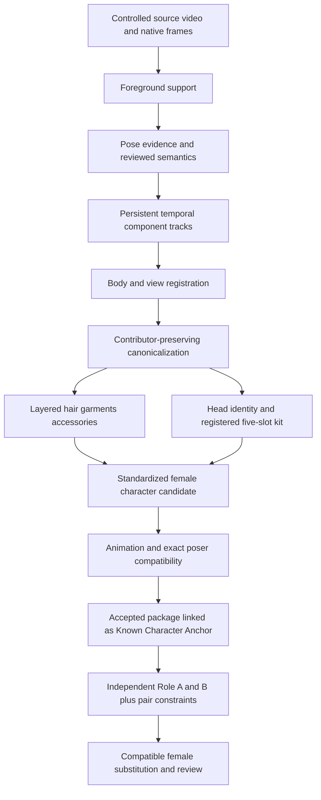

# Proposed production stack

**Proposal for owner review only.** This is a complete intended flow, not an implemented stack or permission to begin production. FEMALE_STANDARD_V1 remains proposed. Universal skeleton1.2.0 and the exact v0.4.13 mannequin remain fixed. All optional model rows are conditional accelerators; an unresolved artifact is never required.

## Technology, fallback and owned boundary at every stage

| Stage | Chosen technology / useful piece | Fallback | Corpus Pane-owned layer | License disposition | Expected runtime architecture | Major unresolved risk |
|---|---|---|---|---|---|---|
| 1. Controlled video ingestion | Existing decode/probe patterns; native PTS, lossless frame identity | Owner-prepared frames plus verified PTS manifest / approved decoder | Source/frame hashes, crop transforms, revisions | Private source rights conditional; installed FFmpeg binary UNRESOLVED for redistribution | Local import/job process; no source upload | Exact production decoder/codec build and ordinary launcher/storage acceptance |
| 2. Foreground extraction | Existing SpriteKeyer/chroma baseline | Reviewed manual alpha/support masks | Foreground observation and correction history | Inherited baseline; notices conditional | Interactive browser path or approved local worker | Fine alpha/green spill; corner diagnostic is not silhouette accuracy |
| 3. Pose evidence | Bundled MoveNet fast; optional measured DWPose ONNX | Manual reviewed poses; explicit fast/multipass retry | Raw observation → skeleton1.2 mapping, visibility and person ownership | Baseline conditional; DWPose model RESEARCH_ONLY until production ledger closure | MoveNet browser WebGL; optional CPU ONNX worker | Side/occlusion, score calibration, hand/foot/face quality not individually validated |
| 4. Semantic separation | Reviewed component labels/prompts + foreground/color/pose hints; SAM mask proposals | Manual semantic masks | Component vocabulary, ambiguity bands, nested garment/skin decisions | SAM code/weights APPROVED_WITH_CONDITIONS; no parser required | Review UI with optional local inference job | Seed contamination, similar colors, accessories and two-person ownership |
| 5. Temporal components | SAM2.1 tiny propagation and correction API | Reviewed key masks, short flow proposals with warnings | Persistent component/person tracks, source masks, corrections, visibility | SAM conditional; Cutie alternative remains UNRESOLVED at checkpoint boundary | Optional Python/CUDA worker, CPU state offload; cancellable/cacheable jobs | Hair boundaries and full occlusion/reappearance remain unaccepted |
| 6. Body/view alignment | Reviewed skeleton/feature anchors; similarity fits / constrained part warp | Manual part registration and separate view candidates | Coordinate/view profiles, correspondences, residuals, rejection | OpenCV core conditional if used; own math otherwise | CPU worker or small JS fit | A mask track does not provide anatomy-correct texture correspondence |
| 7. Multi-frame canonicalization | Non-generative source selection/blending; See-through offset/layer concepts | Single reviewed visible source + explicit UNKNOWN coverage | RGBA/coverage/origin/contributor atlas and generation lineage | Own layer; concepts only; no generative weights required | Local CPU authoring jobs, optional controlled mesh warps | Lighting/fold conflicts and hidden coverage; no measured full reconstruction yet |
| 8. Layered hair/garment/accessory authoring | Adapt Stretchy contours/sampling; Delaunator kernel; manual construction-aware subparts | Rigid authored pieces and pose/view variants | Overlap/seams, local order graph, anatomy binding, distinct artwork pivots/sockets, coverage | Stretchy MIT conditional; Delaunator/robust predicates assessed eligible with notices | Browser Web Worker for meshes, editor and 2D renderer | Automatic splits/weights not certified; 16 mannequin PNGs missing |
| 9. Deformation/pose variants | Reviewed simple skinning and shape keys; optional standalone ARAP offline | Rigid overlap pieces and narrower envelopes | Weight/pin authoring, topology revisions, no-inversion and seam tests | Animated Drawings MIT conditional; numerical dependencies separately pinned | JS/WebGL playback; CPU offline solve/bake initially | ARAP inversion, fixed-scale heuristics, silhouette/order failure at large articulation |
| 10. Head/face registration | Original PXZ rects/trim offsets; reviewed similarity anchors; alpha/stencil and attachment concepts | Preserved source-placement head+kit with manual registration | HEAD_IDENTITY, five independent FACE_KIT slots, masks, gaze/side and compatibility | Owner art conditional; selected MIT/OpenCV helpers conditional; no foreign runtime | Browser layer compositor; optional CPU fitting | Native masks, four gaze gaps, anchors and second kit unverified |
| 11. Standard character package | Corpus Pane-owned composition using fixed skeleton and proposed female family | Incomplete candidate stays needs_review | Family profile/member calibration, stable IDs, modules, exact revisions, acceptance | Source rights and chosen notices must be complete | Local versioned bundle validator/storage | Family tolerances and membership unapproved; no automatic acceptance |
| 12. Animation/poser compatibility | Exact v0.4.13 host, own renderer/bindings plus adapted primitives | Candidate-only preview within unaccepted envelope | Host/part swap tests, 25-pose seams, view/order/no-flip evidence | Host/art rights conditional; no replacement mannequin | Browser preview + deterministic offline checks | Real pilot blocked by16 original PNGs; reference renders cannot substitute |
| 13. Known Character Anchor | Explicit accepted package/source binding, reviewed appearance/pose constraints | Research-only unbound role hypotheses | Anchor identity, projection/visibility uncertainty and competing ownership | Own records + eligible evidence providers | Local association/review process | No linked complete accepted female package currently supplied |
| 14. Paired template extraction | Per-role pose/component evidence plus interaction-graph concepts | Manually authored/reviewed role and relationship channels | A/B motion/root/facing/face/state plus relative/contact/prop/order/timing graph | Papers as references only; no external policy/data/runtime | Local extraction and review; limited CPU constraint solving | 2D nearness/depth ambiguity; contacts and ownership unlabelled |
| 15. Paired substitution | Own bounded relative-root/IK adjustments on compatible female packages | Reject/narrow unsupported interaction/view/garment envelope | Role binding, contact consistency, occlusion transitions and final human acceptance | Own implementation with cleared selected dependencies | Browser replay and offline deterministic validation | No final standardized female replacement proof; mixed-sex stress fixture cannot satisfy it |

## Execution design to prepare at the next gate

Keep interactive editing and deterministic 2D playback in the application. Put heavy optional providers behind a local job boundary rather than forcing CUDA/PyTorch into the browser. A job specifies source hashes, native frame range/PTS, reviewed person/component prompts, provider/checkpoint/config IDs, crop transforms, resource limits and output schema. Return immutable raw evidence, metadata and errors; only a reviewed import can create a canonical candidate. Cancel jobs, detect stale revisions, checkpoint progress and keep provider state distinct from persistent assets.

Load heavy models sequentially under a configured memory cap and unload them when idle. Observed CUDA allocation under1GiB does not prove total-device use or every machine's fit. Provide capability detection and manual fallback. No silent network download, cloud upload, unresolved-model activation or acceptance promotion belongs in the default path.

Production selection must pin exact code, weights, packages, licenses and notices. Sampler/renderer reuse does not inherit a foreign project format; bind all generated mesh/artwork to Corpus Pane's own schema and source evidence. Native PTS, not nominal audio/container duration or a third-party animation timebase, identifies source evidence.

## Preconditions for later acceptance

Full original mannequin artwork; owner-reviewed family/face registration; exact chosen dependency/distribution ledger; ordinary launch/storage and source-preserving roundtrips; timed correction sessions; standardized female Known Character Anchor and replacement packages. These are visible next-gate conditions, not claims fulfilled by the technology harvest. Stop for owner review before any implementation begins.
